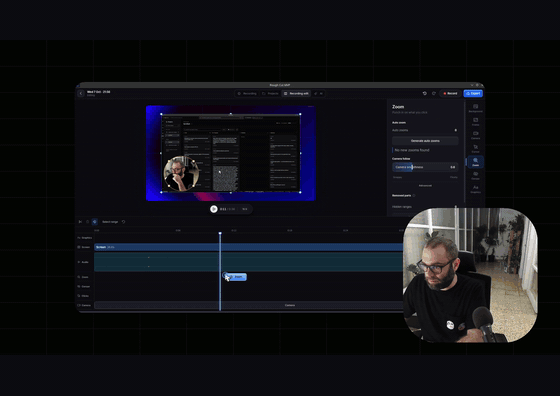
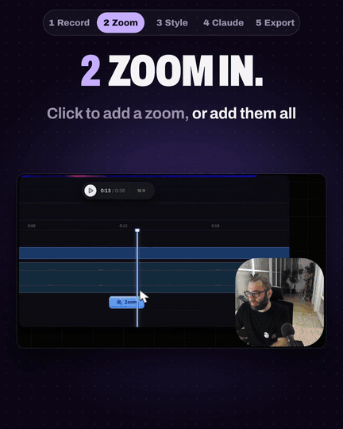
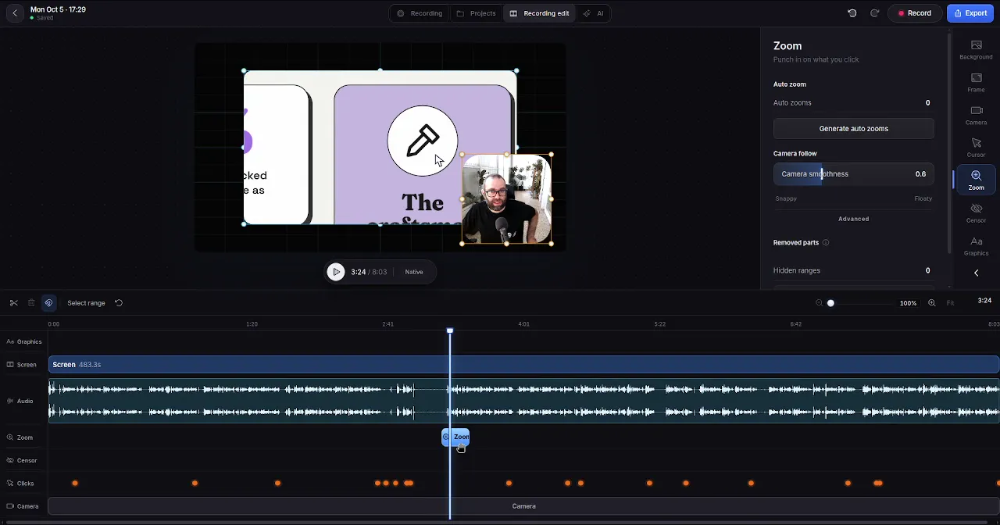
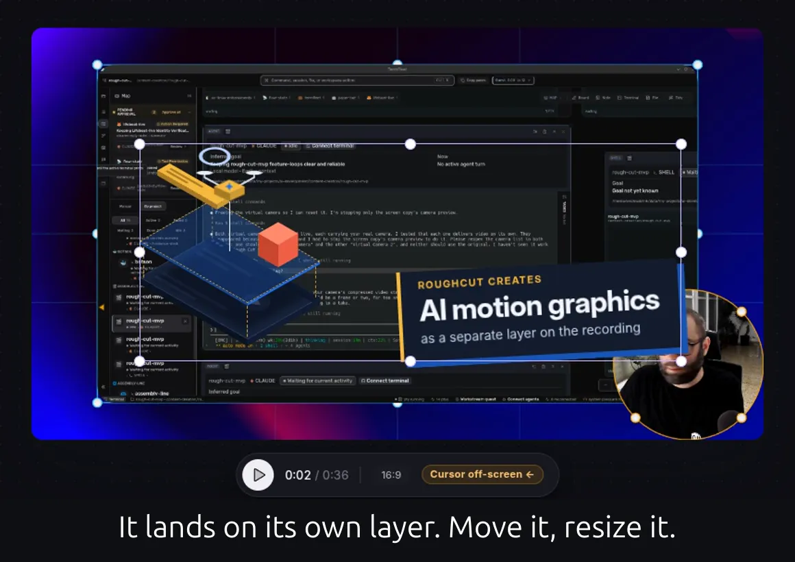
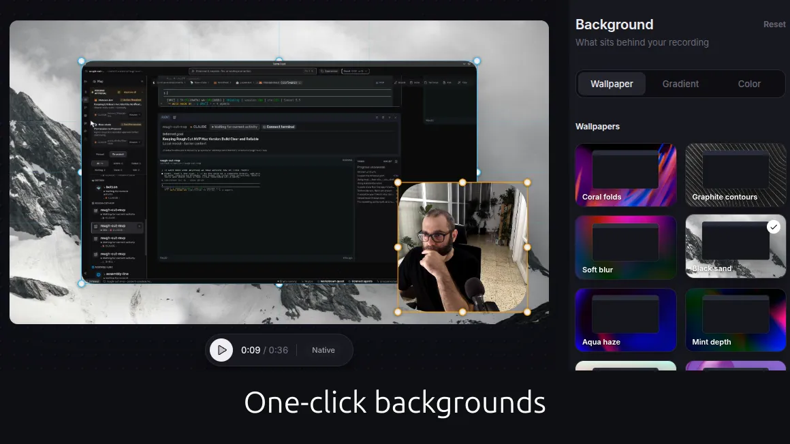
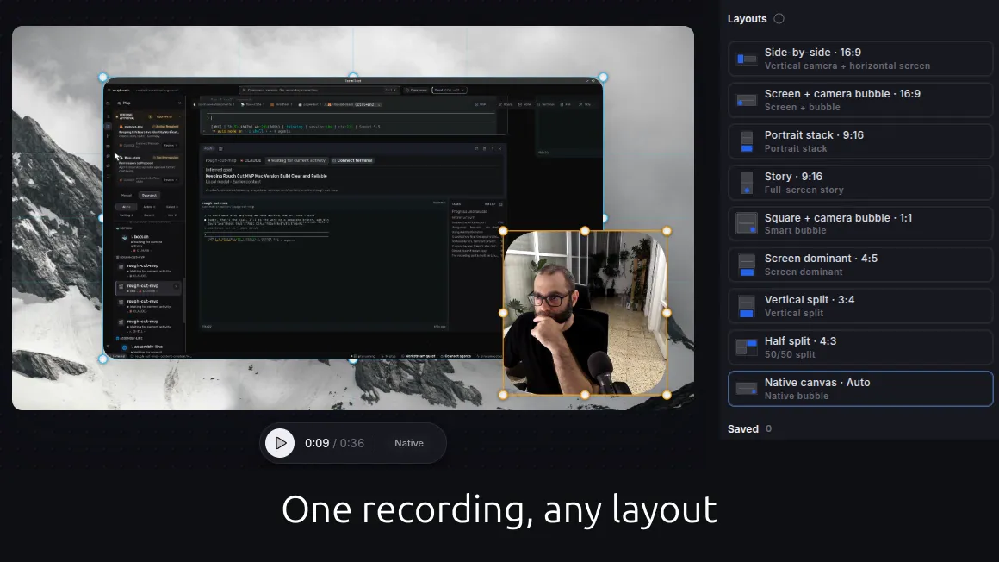
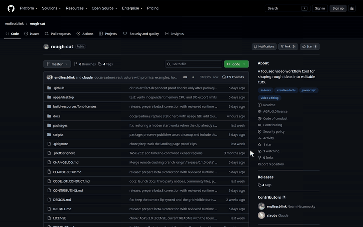

# Rough Cut

**Record your screen, edit it on one timeline, and let Claude draw the graphics. Free, local, open source.**

  

[Get started](#get-started) · [What you can do](#what-you-can-do) · [Examples](#examples) · [Roadmap](#roadmap) · [Website](https://endlessblink.github.io/rough-cut/)

Rough Cut is a free screen recorder and editor for tutorials, demos and product walkthroughs. You record, trim and zoom on one timeline, style the picture, add animated graphics written from a text prompt, and export an MP4. Recording and editing stay on your computer.

A short tour of the whole flow:

## Get started

Linux **x86_64 / X11** only for now. Download the latest build from [GitHub Releases](https://github.com/endlessblink/rough-cut/releases), unpack it and run it. Checksums are listed on the release page; exact filenames and commands are in [INSTALL.md](INSTALL.md).

Then:

1. Open the recording setup, choose the screen and optional microphone, system audio and camera.
2. Press Start, record, press Stop. The take opens in Recording edit.
3. Trim, zoom, style, add graphics, then Export.

Existing recordings can be reopened without recording again.

## What you can do

- Record a display, window area or region, with optional microphone, system audio and camera.
- Seek, split, trim, move and remove linked screen and audio clips. Undo and restore edits.
- Inspect stereo waveforms, resize the Audio lane, and zoom into detailed source windows.
- Add manual zooms, styled cursors, click emphasis, backgrounds, rounded frames and camera layouts.
- Choose landscape, portrait or square compositions and adjust the output size.
- Hide sensitive regions with solid or pixelated censors.
- Add optional Claude-made animated graphics over your video; edit their text, colours and timing.
- Export MP4 with picture and audio. Output is validated before the final file appears.

## Examples

Real clips from the editor, each with the action that produced it.

**Zoom: place a marker on the timeline, the picture glides in and back out.**

**Claude graphics: describe the animation in a sentence, get a live graphic on the timeline.**

| Backgrounds | Layouts |
| --- | --- |
|  |  |

Click any picture to play it. More on the [website](https://endlessblink.github.io/rough-cut/).

## How it works

Rough Cut is an Electron app with one shared timeline. Recording writes the screen, audio, camera and cursor data side by side; the editor plays the same timeline you export. Graphics are small live web pages drawn over the video and rendered into the export. Capture and export use FFmpeg.

Graphics use the official Claude Code CLI through your own Claude subscription. Nothing is sent to Claude unless you ask for a graphic. See [CLAUDE-SETUP.md](CLAUDE-SETUP.md).

## Requirements

| | |
| --- | --- |
| Platform | Linux x86_64 with an **X11** session and glibc 2.35 or newer (Wayland is not supported yet), **or** Windows 10 2004 / Windows 11, 64-bit (preview: see [INSTALL-WINDOWS.md](INSTALL-WINDOWS.md)). |
| Tools | On Linux FFmpeg/FFprobe, xdotool, xinput and pactl are bundled with their libraries and notices. On Windows FFmpeg/FFprobe are bundled. No Node.js or source checkout needed. |
| Tested on | Linux: KDE Plasma with an NVIDIA GPU. Windows: one Windows 11 laptop. Other desktops, GPUs and multi-monitor setups still need testing. |
| Claude graphics | Optional. Needs the `claude` command, logged in. |
| Transcription | Optional. Needs a compatible local engine and model (not bundled). See [CONTRIBUTING.md](CONTRIBUTING.md). |

On NVIDIA, turn **Allow Flipping** off in nvidia-settings (OpenGL Settings); with it on, the screen grab can contain torn frames. This is a beta: back up recordings you cannot redo.

## Roadmap

Planned, no dates. Automatic zoom is deferred; existing experimental code is not a promise.

- **Automatic zoom** that follows the cursor and clicks. Today zooms are placed by hand.
- **Automatic subtitles** from local transcription, styled and burned into the export.
- **Describe an edit** and let an agent cut, zoom and caption a take for you. The result lands on the same timeline, so you can keep editing it by hand.
- **More AI models for graphics**, so they do not depend on one subscription.
- **Wayland recording**, then **macOS**. **Windows** is in preview (unsigned installer, one machine tested); the website has a Mac and Windows waitlist.

## Privacy

Recording and editing stay local. There is no analytics service or automatic crash upload. Help → Crash reports is off by default; each local JSON export shows its exact contents before you choose to save it.

Public update checks are disabled. Graphic prompts and design context go to Claude only when you request generation; recent requests and answers are kept in local diagnostics. Recordings and exports default below `~/Documents/Rough Cut MVP`; settings and logs use the Linux configuration directory (on Windows, `%APPDATA%
ough-cut-mvp`).

## Source, support and license

Release artifacts come with the exact application source, media-tool source archives, SHA256SUMS and license notices. See [THIRD_PARTY_NOTICES.md](THIRD_PARTY_NOTICES.md) and [docs/MEDIA-SOURCE-BUILD.md](docs/MEDIA-SOURCE-BUILD.md).

Report issues on [GitHub](https://github.com/endlessblink/rough-cut/issues), after reviewing attachments for private content. Development instructions: [CONTRIBUTING.md](CONTRIBUTING.md). Security reports: [SECURITY.md](SECURITY.md).

A star helps other people find Rough Cut. If it helps your work, you can [support Noam on Buy Me a Coffee](https://buymeacoffee.com/noamnau). Support is optional; the app remains free.

Copyright (C) 2026 Noam Naumovsky. Free software under [AGPL-3.0-only](LICENSE), including the graphics tool. A paid Pro edition with new features may come later.
