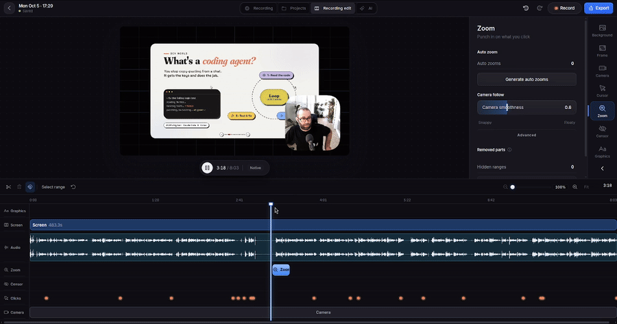
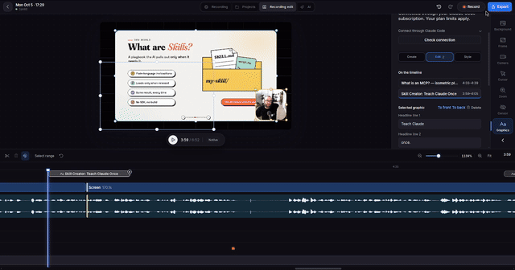
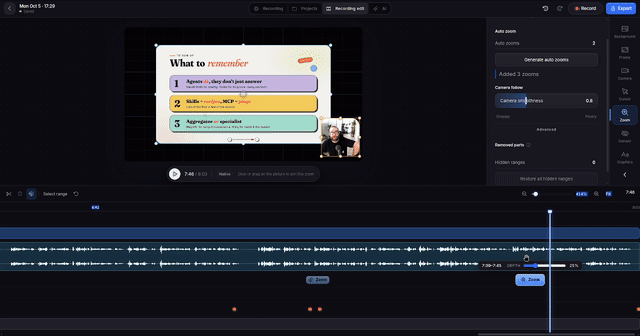
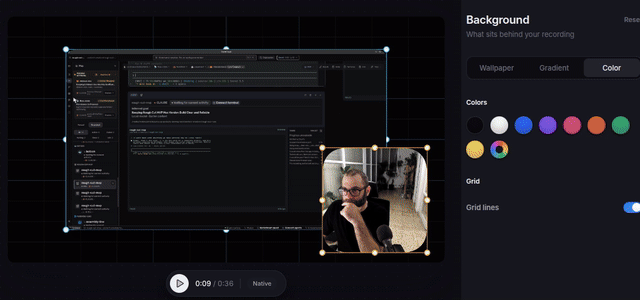
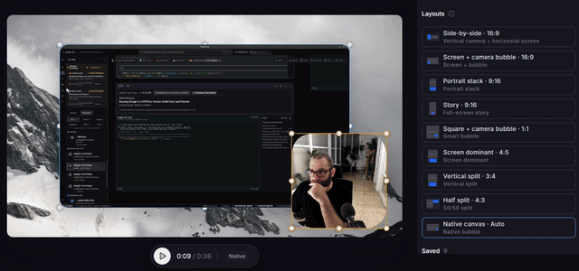

# Rough Cut

**Record your screen, edit it on one timeline, and let Claude draw the graphics. Free, local, open source.**

   

[Download](#download) · [Features](#features) · [Examples](#examples) · [Requirements](#requirements) · [Roadmap](#roadmap) · [Website](https://endlessblink.github.io/rough-cut/)

Rough Cut is a free screen recorder and editor for tutorials, demos and product walkthroughs. Record, trim and zoom on one timeline, style the picture, add captions and animated graphics, and export an MP4. Recording and editing stay on your computer.

## Download

Get the latest build from [GitHub Releases](https://github.com/endlessblink/rough-cut/releases).

| Linux (x86_64, X11) | Windows 10 / 11 (preview) |
| --- | --- |
| Unpack and run. Exact file names, checksums and steps: [INSTALL.md](INSTALL.md). | Run the installer, or unzip the portable build. The build is not code-signed yet: [INSTALL-WINDOWS.md](INSTALL-WINDOWS.md). |

Then:

1. Open the recording setup and pick the screen, plus microphone, system audio and camera if you want them.
2. Press Start, record, press Stop. The take opens in Recording edit.
3. Trim, zoom, style, add captions or graphics, then Export.

## Features

- **Record** a display, window area or region, with optional microphone, system audio and camera.
- **Edit on one timeline.** Split, trim, move and remove linked screen and audio clips, with undo.
- **Zoom and cursor.** Place zooms on the timeline; styled cursor and click emphasis.
- **Captions** on their own timeline lane: transcribe your speech, edit lines in place, switch languages, burn them into the export (Hebrew right to left).
- **Look.** Backgrounds, rounded frames, camera layouts, and landscape, portrait or square output.
- **Censor** sensitive regions with solid or pixelated boxes.
- **Claude graphics.** Describe an animation in a sentence and get a live graphic on the timeline; edit its text, colours and timing.
- **Export** an MP4 with picture and sound. Every export is checked before the file appears.

## Examples

Straight from the editor, nothing added.

| Claude graphics on their own lane | Cuts and zooms on one timeline |
| --- | --- |
|  |  |
| **One-click backgrounds** | **Any layout from one recording** |
|  |  |

More on the [website](https://endlessblink.github.io/rough-cut/).

## Requirements

| | Linux | Windows |
| --- | --- | --- |
| System | x86_64, **X11** session, glibc 2.35+ (Wayland not yet) | Windows 10 version 2004 or Windows 11, 64-bit |
| Bundled | FFmpeg, FFprobe, xdotool, xinput, pactl | FFmpeg, FFprobe |
| Tested on | KDE Plasma, NVIDIA GPU | One Windows 11 laptop |

Optional for both:

- **Claude graphics** need the official Claude Code CLI, logged in with your own subscription. See [CLAUDE-SETUP.md](CLAUDE-SETUP.md).
- **Captions from speech** need a local transcription engine and model (not bundled). See [CONTRIBUTING.md](CONTRIBUTING.md).

On NVIDIA, turn **Allow Flipping** off in nvidia-settings (OpenGL Settings), or the screen grab can contain torn frames. This is a beta: back up recordings you cannot redo.

## Privacy

- Recording and editing stay on your computer. No analytics, no automatic crash upload, no update checks.
- Graphic prompts go to Claude only when you ask for a graphic. Caption translation also goes through Claude, only when you ask for it.
- Crash reports (Help → Crash reports) are off by default and show their exact contents before you save one.

## Roadmap

Planned, no dates:

- **Automatic zoom** that follows the cursor and clicks.
- **Describe an edit** and let an agent cut, zoom and caption a take, on the same timeline you keep editing.
- **More AI models for graphics**, beyond one subscription.
- **Wayland**, then **macOS**. A Mac and Windows waitlist is on the [website](https://endlessblink.github.io/rough-cut/).

## How it works

An Electron app with one shared timeline. Recording writes the screen, audio, camera and cursor data side by side, and the editor plays the same timeline you export. Graphics are small live web pages drawn over the video and rendered into the export. Capture and export use FFmpeg.

## Contributing, support and license

- Bugs and ideas: [GitHub issues](https://github.com/endlessblink/rough-cut/issues) (check attachments for private content first).
- Development: [CONTRIBUTING.md](CONTRIBUTING.md). Security reports: [SECURITY.md](SECURITY.md).
- Sources and notices: every release ships the exact source, media-tool sources and checksums. See [THIRD_PARTY_NOTICES.md](THIRD_PARTY_NOTICES.md) and [docs/MEDIA-SOURCE-BUILD.md](docs/MEDIA-SOURCE-BUILD.md).

A star helps other people find Rough Cut. If it helps your work, you can [support Noam on Buy Me a Coffee](https://buymeacoffee.com/noamnau). The app stays free.

Copyright (C) 2026 Noam Naumovsky. Free software under [AGPL-3.0-only](LICENSE), including the graphics tool. A paid Pro edition with new features may come later.
